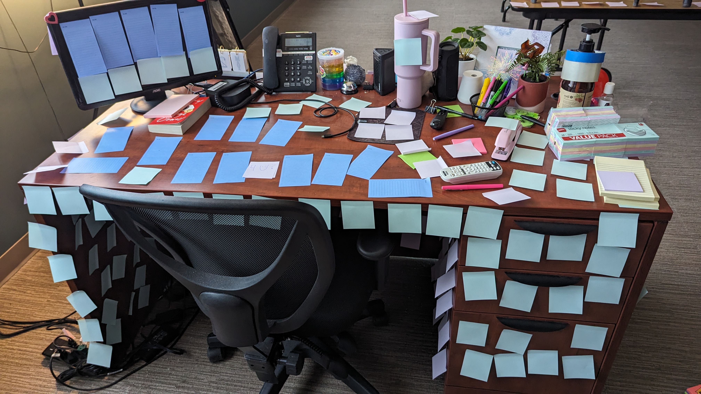

In a fit of fury and rage, in union with some serene overthinking and the reflection, I took an action that seemed a bit crazy, at least within my field of software development. After much deliberation, inner conflicts, and anger at the state of my field, I cancelled my Claude Code subscription. 

"An absurd action", one said. "**Preposterous**", said another. A third exclaimed, "Unheard of".

A lot of factors and related philosophies went into this, but, ultimately, it was a decision rooted in the humanistic ideals ingrained in me since youth. But it is when these ideals overpower the issues that come with new tools that new ideas and revolutions are born, and new schools of thought are passed down through generations, unmoored of the always changing toolset[^6].

## Rejecting Ease & Pursuing Hard Things

An alternate title for this entry was "Do Hard Things". Throughout my experiences in education, in professional positions, and in my personal projects, the concept of rejecting the ease of things for the cognitive strain of hard tasks has arisen again and again. While I am not a psychology major (in another life...), I have learned that doing harder things creates beneficial resilience and has cognitive effects. In an age where software tools have a way of detracting from our autonomy, it often is the case that deliberately choosing ways around certain developments lead to cognitive strengthening, increased skills, and fostering human-centered thinking. 

A direct case of this was the creation of Facebook[^1]. Those who saw 2010 film *The Social Network* know that it was originally created as a college directory for connecting students. As it became a growth-centered company, its initial vision was to foster the social humans experience to be apart of a community; to support the drive to be connected. As it went on, however, the opposite happened: people who spent more time on Facebook felt significantly less connected. Whether this is due to social comparison, the ramification of detracted human-centered interaction, the dopamine loop effects, decreased attention-spans, algorithmic content flows (wow... this list could go on and on), Facebook (and similar platforms) do not do what they intended to do. These platforms take away the difficult action of becoming yourself through interacting with individuals. 

The same exact argument is true for AI (much to my displeasure). Now, I have had the both polar sides of the experience regarding AI usage. At certain points in my field, I have had to sit with and manage two-three different AI agents, all working on different features for systems at work. Being in the position of feeding different prompts and switching between 3 different chats, all of which "speak" in the same syntax of "Absolutely! Let's take a crack at it, breaking it down step by step" or "its not `a`, its `b`" is not only psychologically deteriorating but also very much demoralizing at times[^5]. The dehumanization of just sitting around and awaiting a new change to appear can be quite unfulfilling. 

I have also often sat with coding problems when rejecting AI usage and become extremely frustrated, feeling the psychological strain deeply. I have sat with proofs like the *[Handshaking Lemma](https://resources.saylor.org/wwwresources/archived/site/wp-content/uploads/2013/04/Handshaking-lemma.pdf)* for hours on end, and, upon truly understanding the proof, I have felt much more passionate and satisfied about the work spent on it.

My programming skills have been compounded and expanded greatly by access to these tools like Claude Code would not have gotten me the jobs or allowed me to make certain things such as my website (which was initial factor to getting access to Claude Code). Still, as an individual who finds meaning in valuing the humanistic experience (or lack thereof), I feel such an innate evil by doing so and having had the ability to watch a vision come to life was incredible, yet entirely unfulfilling.

A third example of this is, while this is extremely "meta" and surreal, is the fact that I have a created blog. The two most psychologically rewarding activities to me, that I have found through depth of experience, are reading books and creating new writing. Being able to digest a high-quality classic and compile the millions of ideas that race through my brain from my lived experiences into a substantive piece of literature (writing about what I read is even more meta, and so incredibly helpful for attention span) are two ways, at least that I have found, to keep my mind fresh — to be passionate about what it truly means to be human. 

## Passion & Creation

Another up-and-coming notion that piqued my interest is the new Harvard Course Humanities 10a, often referred to as *Hum10*[^2] by the students. In short, Harvard's newly released course *Hum10* has a curriculum sequence spanning many classicists: Homer, Plato, Descartes, Shakespeare, Shelley, Kafka... the list goes on[^3]. The rigorous texts, technology bans, and intense Socratic discussions already cloud this course with extreme difficulty and suspense, not to mention the application-based enrollment into the class.

What has drawn me in, as well as with many educators from around the country, is that this course had an interest list of more than double its enrollment cap of 90. Why would so many students want to deep dive into some of the hardest classics of the best two and a half centuries? Sure it is not the curriculum, right? While there is no true way to confirm, many of these students are becoming passionate about rebelling against the software that tries to master their minds. 

> Some students in the reporting describe wanting protection from shortcuts and fragmented attention. That is meaningful testimony about their experience.[^2]

The ability to process these texts gives the students such a defense on ominous softwares of the world[^1]. With everything trying to steal their attention, these students are starved of making their own deliberate and disciplined choice of direct their focus.

I truly feel that it is honestly refreshing that students our day and age are recognizing the deterioration that certain digital tools can cause. Becoming overwhelmingly obsessed with a new project or an idea from the brain is the best defense against the existential dread the often comes in the moments of silence and emptiness. My own experience has led me to find that I am most passionate about life when I am creating, working on aesthetic projects, when finding beauty within the chaos[^7]. 

## Do Less but Better
The idea of **do less but better** is one that has mesmerized my vision often. This idea was first introduced to me when reading Greg McKeown's *Essentialism*[^8], a non-fiction book about the pursuit of doing fewer things to a higher quality level. It has been about four years since I've read this book, but I believe one of the core principles stands with me today: 

>  Pick and commit to the top 90% of opportunities, let the mediocre ones pass even if it seems vital in the moment.

While I have a habit of overcommitting, reflection leads me to points of slowing down and ensuring that I am following this idea to best I can, and noticing when I am not. But when there is a choice, having less on the list leads higher quality creation.

Just as the industrial revolution and cars were sped up by assembly lines, AI is speeding up cognitive assembly lines[^5] (paraphrased from Cal Newport). It is so important to recognize that all of these creative ideas need an output, and it remains demoralizing to offload this creativity to AI tools or automated return softwares (like Canva or Figma or Powerpoint). Sitting there, supervising agents is a miserable, solitudinal approach to work, in my experience as discussed above, deliberately enforces a lack of creativity and instead creates a sense of dehumanization.  

I recently was talked to by a well-respected professor of mine at Cal Poly who described the *practice* of Software Engineering akin to that of *candle-making*. Odd analogy, I thought, but as he explained, there are craftsmen who still remain today to be masters of candle-making. There are tools that allow for the wax to molded, carved, shaped into unique shapes, and dyed gradients that aren't possible on the color wheel; the entire process of producing a candle can be automated start to finish. 

Great, right? What about those individuals who are passionate about the creation of candles, those which put effort into their craft and practice to ensure the candle is made with love, carefully crafted, and intricately ordained with details. In software development, there may be some candlemakers — those who rise to their height of the craft while choosing to reject the notion of the new tools. The whole idea of *token-maxxing* (in short, optimizing the number of code changes per session) as a measure of valuable output to a project is an inadequate signal of closure to the brain. Taking time to fall in love struggle of a select problem, to me, is the best method pursuing a smaller number of high quality things[^4].

### Case Study: *In Color*
The cinematic pop / alternative rock band In Color hit the music scene with their first single [Headlights](https://open.spotify.com/track/7G2u32iWqPhkg2u1z4WCZP?si=c416b3b368764da7) on Valentine's Day of 2025. That song is currently their most popular song sitting close to 29 million streams on Spotify as of time of writing. As of November 2026, they have released 13 songs across one EP and a sprinkling of singles. While their online existence has not even reached its two year anniversary, I believe that their genre-breaking production is one that is shattering. Every single song they have released is filled with some of the highest-quality production on a track I have ever heard[^9] (it is quite hard to write about the quality of music...). This combined with their limited discography, for me, is a testament that they are choosing the "less but better" route of music production. 

## Conclusion

Out from the chaos comes, hopefully, a bit of order and learning. The three ideas circling this post — *creativity and passion*, *do hard things*, and *do less but better* — are ideas the circle my mind daily will continue to entrance my value-oriented goals once again.

I am not sure whether I am able to reject the usage of AI forever, especially when the field of Software Development is what consecrated is birth. It is quite conflicting being an individual valuing the humanistic order of life while being stuck in what I see as the **AI epicenter**. I do know, however, that I can make the harder choice to avoid such the numbing and depriving of dignity that comes with its ease[^5]. In outlining my passions has led me to be passionate not about the amount of features I can push, but about how digital creation and cognition can intertwine to combat psychological deterioration.

See the footnotes for videos, ideas, and books that inspired these thoughts.

[^1]: [Cal Newport: Reading as an Act of Resistance](https://open.spotify.com/episode/7gOYUM78fzlvdN5UMCNI1S?si=6bcae2ca9bdc4130)

[^2]: https://openthemagazine.com/world/explained-what-is-harvards-hum-10-and-why-are-students-queuing-up-to-read-difficult-books

[^4]: [Cal Newport: Do Hard Things](https://open.spotify.com/episode/2qhgEQtkY1kEBgmtYek5Pv?si=eb6a924c689b4b37)

[^5]: [An AI Resistance (ft. Brad Stulberg, author of *The Way of Excellence*)](https://youtu.be/OYwJz-Pypvo?si=dBZ8p_wQv13DCxMX)

[^6]: [*A World Without Email* by Cal Newport](https://www.goodreads.com/en/book/show/54326146-a-world-without-email)

[^7]: [Create your own things, Scott Yu-Jan](https://www.youtube.com/watch?v=9FHjfzS4BqQ)

[^8]: [Greg McKeown's Essentialism](https://gregmckeown.com/books/essentialism/)

[^9]: [On *In Color*'s High](https://comfortcrowdmag.com/in-color-reaches-new-heights-with-high/)
